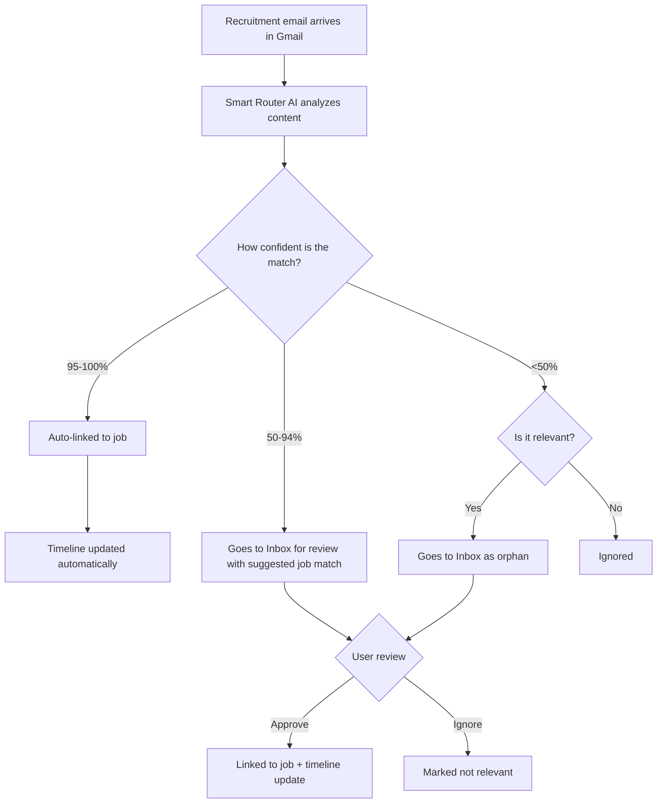

The easiest way to run JobOps is via Docker Compose. The app is self-configuring and guides you through setup on first launch.

## Prerequisites

- Docker Desktop or Docker Engine + Compose v2

## 1) Start the stack

Example Docker Compose file:

```yaml
---
services:
  job-ops:
    build:
      context: .
      dockerfile: Dockerfile
      secrets:
        - github_token
    image: ghcr.io/dakheera47/job-ops:latest
    container_name: job-ops
    ports:
      - "3005:3001"
    volumes:
      # Persist database and generated PDFs
      - ./data:/app/data
      # Persist Codex login/session data for app-server provider
      - codex-home:/app/codex-home
    environment:
      # Server config
      - NODE_ENV=production
      - PORT=3001

      # Python path (uses system python in container)
      - PYTHON_PATH=/usr/bin/python3
      # Codex runtime home (stores auth and config)
      - CODEX_HOME=/app/codex-home

    env_file:
      - path: ./.env
        required: false
    develop:
      watch:
        # Rebuild container when package.json changes
        - path: ./orchestrator/package.json
          action: rebuild
        - path: ./orchestrator/package-lock.json
          action: rebuild
        # Sync source code changes and rebuild inside container
        - path: ./orchestrator/src
          target: /app/orchestrator/src
          action: sync+restart
        - path: ./career-boards/bamboohr/src
          target: /app/career-boards/bamboohr/src
          action: sync+restart
        - path: ./career-boards/workday/src
          target: /app/career-boards/workday/src
          action: sync+restart
        # Sync extractor changes
        - path: ./extractors/hiringcafe/src
          target: /app/extractors/hiringcafe/src
          action: sync+restart
        - path: ./extractors/jobindex/src
          target: /app/extractors/jobindex/src
          action: sync+restart
        - path: ./extractors/jobspy
          target: /app/extractors/jobspy
          action: sync+restart
    restart: unless-stopped
    healthcheck:
      test: ["CMD", "curl", "-f", "http://localhost:3001/health"]
      interval: 30s
      timeout: 10s
      retries: 3
      start_period: 10s

secrets:
  github_token:
    environment: GITHUB_TOKEN

volumes:
  codex-home:
```

No environment variables are required to boot.

```bash
docker compose up -d
```

This pulls the pre-built image from GHCR and starts the API, UI, and scrapers in one container.

To build locally instead:

```bash
docker compose up -d --build
```

If GitHub rate limits the Camoufox download during local builds, set an
optional `GITHUB_TOKEN` in your shell or `.env` first:

```bash
echo "GITHUB_TOKEN=ghp_your_token_here" >> .env
docker compose up -d --build
```

JobOps passes this token to the Docker build as a BuildKit secret only for the
Camoufox download step. It is not stored in the runtime container
environment.

## 2) Access the app and onboard

Open:

- **Dashboard**: `http://localhost:3005`

The onboarding flow saves three durable setup decisions:

1. **Workspace account**: On brand-new installs, create the first username/password account directly in onboarding. This first account becomes the system admin and owns the initial private workspace.
2. **Search preferences**: Select a required country, optionally enter preferred cities, and choose workplace styles. Remote, hybrid, and onsite are selected by default. JobOps uses these values as defaults for future runs.
3. **LLM provider**: Choose OpenRouter by default, or connect another supported hosted or local provider such as Atlas Cloud or a LiteLLM proxy. The step completes only after the server verifies and persists the connection.
4. **Resume review**: Upload a PDF, DOCX, or resume JSON file. JobOps shows the parsed resume and requires confirmation of the current document before setup completes.

Search terms are not part of onboarding. Choose or edit them when starting your first run.

Settings and user accounts are saved to the local database. If you are upgrading an older single-user install, JobOps migrates existing rows into one default private workspace. When `BASIC_AUTH_USER` and `BASIC_AUTH_PASSWORD` are present during that migration, they seed the first system admin account; otherwise onboarding requires first-run account setup before private APIs are usable.

System admins can create and manage users from **Users** in the sidebar (and **Settings → Environment & Workspaces** when configured). Each created user receives a separate private workspace with isolated jobs, settings, resumes, integrations, PDFs, pipeline runs, chat, analytics, and post-application data.

### What invited users can and cannot do

Your server's environment (`LLM_API_KEY`, `MODEL`, `LLM_BASE_URL`, Adzuna, Gmail OAuth app, `WEBHOOK_SECRET`) belongs to the operator and is never shown to non-admin users in Settings. Stored keys and secrets are masked (`••••••••`) without revealing key prefixes. Only system admins and accounts explicitly granted access may use server resources:

- **AI**: Each user is off the server's default AI model until an admin grants **Access to default AI model**. Without that permission, users must add and verify their own public provider API key during onboarding (or in **Settings → Models**) before running Job Ops. CLI providers (`codex`, `gemini_cli`, `claude_cli`), local/proxy providers (`ollama`, `lmstudio`, `litellm`), and custom base URLs are restricted to admins.
- **Settings visibility**: **Environment & Workspaces** (`environment`) and **Danger Zone** are hidden from non-admin users in Settings and blocked on the API. **Resumes & library** also hides the **Resume & PDF** settings section and `/pdfs/` downloads when disabled.
- **Sources**: Sources that need operator credentials (Adzuna and similar) are skipped for non-admin users unless **Use server job-source keys** is enabled for them.
- **Integrations**: Backups, the challenge viewer, and Codex sign-in are admin-only. Webhooks and the Tracking Inbox (Gmail) are off for invited users until an admin switches them on for that user.
- **Limits**: Sign-in, searches, URL fetches, and AI actions are rate limited, and at most `MAX_CONCURRENT_PIPELINES` searches (default 3) run across all users at once.
- **Fetching links**: Job-page fetches and non-admin webhooks only reach public http(s) hosts; redirects are re-checked and responses are size-capped.
- **Static hardening**: Stored PDFs under `/pdfs/` require sign-in, the **Resumes & library** permission, and only the owning workspace folder is readable. Extractor health endpoints require sign-in. `/ojcp/mcp` and `/.well-known/ojcp.json` are off unless `OJCP_ENABLED=1`. CORS allows only the same origin, `APP_PUBLIC_URL`, `JOBOPS_PUBLIC_BASE_URL`, and `CORS_ALLOWED_ORIGINS`.
- Accounts created by an admin must change their password at first sign-in unless the admin opts out.

### Inviting people and controlling their access

Open **Users** in the sidebar as a system admin.

- **Invitations**: Enter a label (who it is for), pick an expiry (1 to 30 days) and the access they start with, then **Create invitation**. JobOps shows a one-time link such as `https://your-host/invite/<token>`; copy it and send it yourself (JobOps sends no email). The invitee picks their own username and password and gets a private workspace. A link works once, can be revoked while it is pending, and only its hash is stored. There is no open signup in local mode.
- **Per-user access**: Each non-admin user has switches organized under **Pages & features** and **AI & server access** that you can change at any time:

  | Switch                     | Default | What it controls                                                                |
  | -------------------------- | ------- | ------------------------------------------------------------------------------- |
  | Job posts                  | on      | Viewing job feeds, searching, scoring, and importing links                      |
  | Watchlist                  | on      | Managing monitored career pages and fetching watchlist jobs                     |
  | In-progress jobs           | on      | Using the application board, stages, notes, and outcome tracking                |
  | Resumes & library          | on      | Managing the Candidate Library, tailored resumes, and PDF generation/downloads  |
  | Access to default AI model | off     | Lets the user run on the server's default model; off requires their own API key |
  | Use server job-source keys | off     | Running job sources backed by your server's Adzuna credentials                  |
  | Email tracking inbox       | off     | Connecting Gmail and the Tracking Inbox                                         |
  | Webhooks                   | off     | Saving outgoing webhook URLs                                                    |
  | Run job searches           | on      | Starting the discovery pipeline                                                 |
  | Import jobs from a URL     | on      | Server-side fetching of a job page                                              |

  System admins always have every switch. Changes apply within seconds.

- **Accounts**: Disable a user, reset their password, or create one directly with a temporary password from the same screen.

## Hosted single-tenant mode

JobOps defaults to local/self-hosted mode when hosted flags are unset. Hosted mode is an env-gated deployment mode for running one configured tenant with multiple users in that tenant.

To enable hosted mode, set:

```bash
JOBOPS_APP_MODE=hosted
JOBOPS_HOSTED_TENANT_ID=tenant_hosted
```

`JOBOPS_HOSTED_TENANT_ID` is required in hosted mode. JobOps fails startup if `JOBOPS_APP_MODE=hosted` is set without a hosted tenant ID. The tenant must already exist in the database before hosted signup can create users for it; hosted signup does not create tenants.

Optional hosted capabilities default to disabled:

```bash
JOBOPS_HOSTED_SIGNUPS_ENABLED=false
JOBOPS_HOSTED_PLATFORM_LLM_ENABLED=false
JOBOPS_HOSTED_QUOTAS_ENABLED=false
```

These flags only affect hosted mode. Leaving `JOBOPS_APP_MODE` unset keeps the current first-run setup, private-workspace user creation, settings, and local behavior unchanged.

When `JOBOPS_HOSTED_PLATFORM_LLM_ENABLED=true`, every hosted account uses the deployment's configured LLM provider, model, and credentials. Free and Pro accounts share that AI configuration; their monthly hosted limits remain different.

When hosted mode is active, first-run setup is disabled. Hosted users must be created through hosted signup when `JOBOPS_HOSTED_SIGNUPS_ENABLED=true`, or by a later tenant-owner/admin user-management flow. Hosted signup appears on `/sign-in` as a **Create account** tab only when hosted mode and hosted signups are both enabled.

The Tracking Inbox is available only in local/self-hosted mode. Hosted mode hides it from navigation and redirects direct `/tracking-inbox` links to **Overview**.

## Single sign-on

JobOps can accept sign-ins from Google, GitHub, or a generic OpenID Connect provider alongside its own username/password accounts. Providers are enabled with environment variables, and each user connects one from **Settings → Environment & Workspaces → Security → Connected accounts**.

Behind a TLS-terminating reverse proxy, set the public URL explicitly so the registered redirect URI matches:

```bash
SSO_REDIRECT_BASE_URL=https://your-domain.com
SSO_GOOGLE_CLIENT_ID=your-client-id.apps.googleusercontent.com
SSO_GOOGLE_CLIENT_SECRET=your-client-secret
```

For provider-by-provider setup, redirect URIs, and just-in-time account creation, see:

- [Single Sign-On Setup](/docs/next/getting-started/sso-setup)

## Codex sign-in

For full Codex auth troubleshooting (including device-code authorization errors), see:

- [Codex Authentication](/docs/next/getting-started/codex-auth)

## Gmail OAuth (Tracking Inbox)

If you want Gmail integration, configure OAuth credentials.

### 1) Create Google OAuth credentials

In Google Cloud:

1. Configure OAuth consent screen.
2. Enable Gmail API.
3. Create OAuth client ID (`Web application`).
4. Add redirect URI:

- `http://localhost:3005/oauth/gmail/callback`
- Or your production URL, for example `https://your-domain.com/oauth/gmail/callback`

### 2) Configure environment variables

- `GMAIL_OAUTH_CLIENT_ID` (required)
- `GMAIL_OAUTH_CLIENT_SECRET` (required)
- `GMAIL_OAUTH_REDIRECT_URI` (optional, recommended in production)

### 3) Restart and connect

- Restart container
- Open Tracking Inbox and click **Connect Gmail**

For a full step-by-step setup, exact scope requirements, and troubleshooting, see:

- [Gmail OAuth Setup](/docs/next/getting-started/gmail-oauth-setup)

## Email-to-job matching overview



## Persistent data

`./data` bind-mount stores:

- SQLite DB: `data/jobs.db`
- Generated PDFs: `data/pdfs/`
- Cloudflare challenge cookies: `data/cloudflare-cookies/`

## Public demo mode

Set `DEMO_MODE=true` for sandbox deployments.

Behavior in demo mode:

- Anonymous read-only access to the seeded demo workspace
- Works locally: browsing/filtering/viewing timelines
- Simulated: pipeline run/process/rescore/pdf/apply
- Blocked: settings writes, DB clear, backups
- Disabled: first-run account setup
- Auto-reset: every 6 hours

## Updating

```bash
git pull
docker compose pull
docker compose up -d
```

## Local PDF rendering

JobOps renders PDFs locally with one of 2 renderers:

- `latex`: render locally from tailored resume data using LaTeX and `tectonic`
- `typst` (default): render locally from tailored resume data using Typst and a selectable theme

When using local renderers:

- The Docker image installs `tectonic` and `typst` for you.
- For non-Docker local runs, install `tectonic` yourself and optionally set `TECTONIC_BIN` if it is not on your `PATH`.
- For non-Docker local runs with Typst, install `typst` yourself and optionally set `TYPST_BIN` if it is not on your `PATH`.

After you import a base resume, JobOps stores it locally; edit it at `/resumes/base` in the [co-work resume editor](/docs/next/features/design-resume). Local renderers use the stored resume document at render time.
